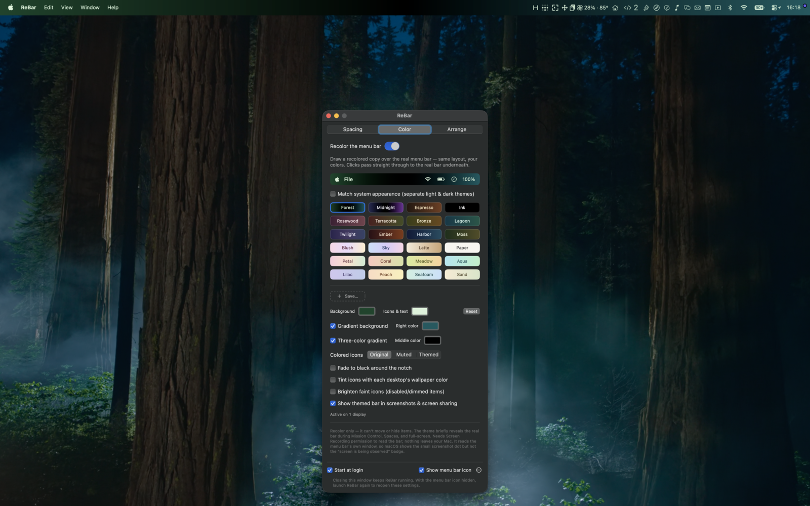
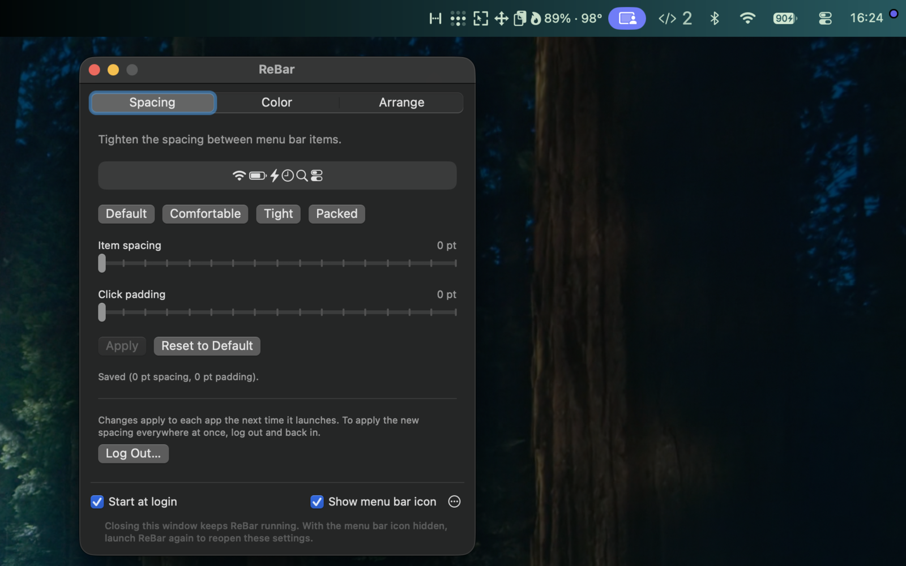
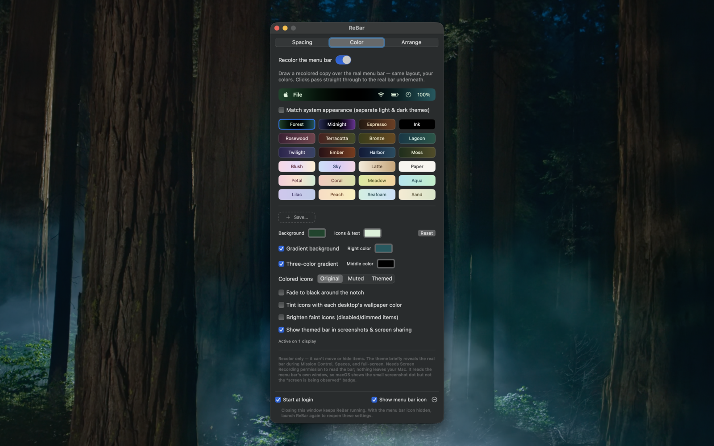
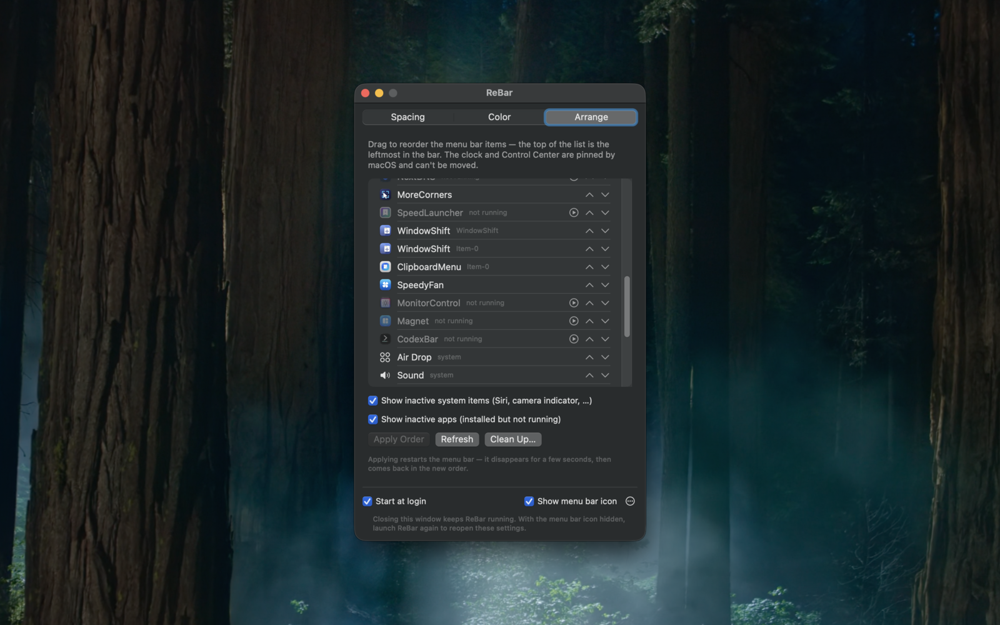

# ReBar


A macOS utility for people whose menu bar is full. Tighten the spacing between
items, recolor the bar, and put the items in the order you want.



## Features

### Spacing

Shrink the gap between menu bar items — from the system default of 16 pt all
the way down to zero — using sliders or presets.

macOS reads the spacing once per app, at launch, so a change applies to each
app the next time it starts. The **Log Out…** button applies it everywhere at
once.



### Color

Recolor the menu bar with solid colors or 2- and 3-stop gradients, with
separate light and dark themes. Ships with presets and lets you save your own.
Genuinely-colored icons (the low-battery indicator, for example) can be kept as
they are, muted, or repainted to match. Optional extras include a fade around
the notch, per-desktop wallpaper tinting, and whether the color shows up in
screenshots and screen sharing.



ReBar reads the real bar and draws a click-through overlay on top of it,
so clicks still land on the real items underneath. When the bar is hidden —
by a full-screen app, or by the "Automatically hide and show the menu bar"
setting — the overlay steps aside too, and comes back the moment the bar does,
hover-reveals included. It reads the menu bar's own
window rather than the screen, one screenshot at a time, so macOS lights only
the small screenshot dot and not the wide "your screen is being observed"
capsule that a continuous capture raises. This still needs **Screen Recording**
permission. The captured pixels never leave your Mac.

### Arrange

Drag menu bar items into the order you want — third-party items plus movable
system ones like Wi-Fi and Battery. The clock and Control Center are pinned by
macOS and can't be moved.

- Items belonging to installed-but-not-running apps are listed too, greyed out
  and with a button to launch them.
- **Show inactive system items** reveals items that are movable but currently
  hidden, such as Siri and the camera indicator.
- **Clean Up…** removes stale entries left behind by uninstalled apps.



Applying an order restarts the menu bar, so it disappears for a few seconds
before coming back. The layout is backed up to
`~/Library/Application Support/ReBar/` before every change.

### Elsewhere

Runs in the background with an optional menu bar icon, can start at login, and
exports and imports its settings as JSON.

## Install

Download the latest `.dmg` from the [Releases](../../releases) page, open it,
and drag **ReBar** to Applications.

If macOS blocks the app the first time you open it, right-click it and choose
**Open**, or approve it under System Settings → Privacy & Security.

### Permissions

| Permission | Needed for |
| --- | --- |
| Screen Recording | The Color tab |
| Automation (System Events) | The **Log Out…** button on the Spacing tab |

Spacing and Arrange need no special permissions.

## Building

Requires full Xcode — the SwiftUI macros need the complete toolchain, not just
the Command Line Tools.

```sh
./build.sh                 # build/ReBar.app
./build.sh --dmg           # …and package it as build/ReBar.dmg
./build.sh --sign          # …Developer ID sign it, notarize and staple
./build.sh --publish v1.2  # tag and cut a GitHub release from the .dmg
```

Flags combine, so `./build.sh --sign --publish v1.2` does the whole release in
one go. If Xcode isn't your default toolchain, point `DEVELOPER_DIR` at it:

```sh
DEVELOPER_DIR=/Applications/Xcode-beta.app/Contents/Developer ./build.sh
```

To work in Xcode, generate the project with
[XcodeGen](https://github.com/yonaskolb/XcodeGen) — it isn't checked in:

```sh
brew install xcodegen   # once
xcodegen generate
```

## Compatibility

macOS 15 or later. Color and Arrange depend on undocumented system behavior
that Apple changes between releases, so expect them to be version-sensitive.
